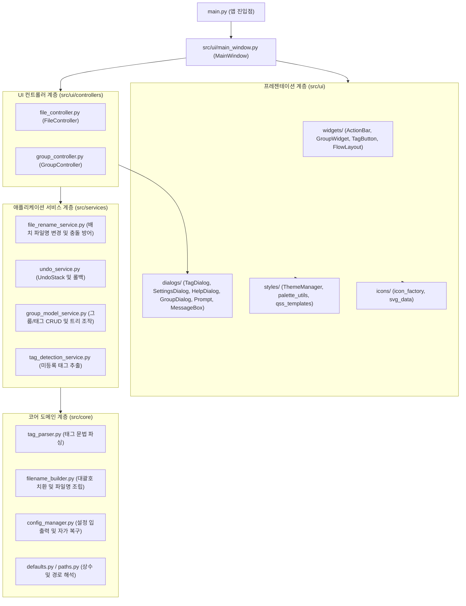

# Easy Tagger 아키텍처 및 모듈 설계

## 1. 핵심 설계 원칙

* **단일 책임 원칙 (SRP)**: 도메인 파서, 파일 조립기, 파일시스템 변경기, 실행 취소 스택, 그룹 모델, UI 컨트롤러, 뷰 위젯이 각 1개의 명확한 책임을 전담
* **높은 응집도 (High Cohesion)**: 위젯과 해당 위젯 전용의 스타일 계산·헤더 프레임은 위젯 모듈 내부에 캡슐화하여 관련 로직 파악 및 유지보수 용이성 확보
* **의존성 역전 및 계층 격리 (DIP)**: `src/core/`와 `src/services/`는 `PyQt6` GUI에 전혀 의존하지 않는 순수 도메인 계층으로 구현하여 헤드리스 단위 테스트 가능
* **경량 모듈화**: 모든 파이썬 파일이 70~250줄 내외의 적정 규모를 유지하며, 불필요한 간접 참조(Indirection) 방지

---

## 2. 계층형 아키텍처 다이어그램

---

## 3. 모듈별 역할 및 책임 목록

### ① 코어 계층 (`src/core/`) — Qt 비의존 순수 도메인
* **`paths.py`**: 개발 환경 및 `PyInstaller` 번들 환경(`_MEIPASS`) 리소스 경로 해석
* **`defaults.py`**: 버전 정보, 파스텔 프리셋 팔레트, 초기 템플릿 기본값 정의
* **`tag_parser.py`**: 일반 태그, 고정 속성 태그(`-key val`), 입력형 속성 태그(`-key ?`) 문법 파싱 및 판별
* **`filename_builder.py`**: 파일명에서 태그 추출, prefix/suffix 및 merged/separate 형식 파일명 조립
* **`config_manager.py`**: `config.json` 로드/저장, `config.init.json` 부재 시 자동 복구(Self-Healing), 구버전 마이그레이션

### ② 서비스 계층 (`src/services/`) — 비즈니스 및 파일시스템 연산
* **`file_rename_service.py`**: 다중 파일 일괄 태그 추가/제거 실행, 동일 파일명 충돌 및 파일 부재 에러 처리
* **`undo_service.py`**: 배치 단위 작업 이력 스택 관리 및 원본 파일명 롤백 처리
* **`group_model_service.py`**: 그룹 및 태그의 인메모리 생성, 수정, 복제, 삭제, 순서 변경, 그룹 간 이동 연산
* **`tag_detection_service.py`**: 파일명에 포함된 미등록 태그 감지 및 휘발성 `감지된 태그` 그룹 생성

### ③ UI 계층 (`src/ui/`) — PyQt6 프레젠테이션
* **`icons/`**:
  * `svg_data.py`: Lucide 기반 인메모리 벡터 SVG 정의
  * `icon_factory.py`: HiDPI 다중 배율 래스터화 및 테마별 QIcon/QPixmap 캐싱
* **`styles/`**:
  * `palette_utils.py`: 휘도 기반 대비 텍스트 색상 계산, 다크모드 파스텔 톤다운, Windows DWM 타이틀바 색상 동기화
  * `qss_templates.py`: 메인 창, 대화상자, 툴팁, 콤보박스 통합 QSS 템플릿
  * `theme_manager.py`: 테마 적용 총괄 파사드
* **`widgets/`**:
  * `action_bar.py`: 활성 파일 상태바, 파일 편집 닫기, 새 그룹 버튼, 햄버거 드롭다운 메뉴
  * `group_widget.py`: 접기/펼치기 헤더 프레임, 태그 FlowLayout 컨테이너, Ctrl+드래그 그룹 재정렬
  * `tag_button.py`: 태그 버튼 뷰, 3단계 활성 상태 렌더링, 폰트 매트릭스 기반 동적 너비 계산, 탐색기 파일 드롭 수신
  * `flow_layout.py`: 창 너비에 맞춘 가로 자동 줄바꿈 커스텀 `QLayout`
* **`dialogs/`**:
  * `tag_dialog.py`: 통합 태그 입력 및 파스텔 색상 피커(`PastelColorPicker`) 내장 대화상자
  * `settings_dialog.py`: 테마, 태그 위치, 괄호 스타일, 버튼 높이, 상단 고정 설정
  * `help_dialog.py`: 마우스 제스처, 단축키, 속성 태그 안내
  * `group_dialog.py`, `prompt_dialog.py`, `message_box.py`: 테마가 동기화된 입력/확인 대화상자
* **`controllers/`**:
  * `file_controller.py`: 활성 파일 추적, 버튼 클릭 시 일괄 토글/적용, 실행 취소 제어
  * `group_controller.py`: 그룹/태그 CRUD 대화상자 연동 및 드래그 재정렬 제어
* **`main_window.py`**:
  * 최상위 윈도우 셸, 단축키 배선, 윈도우 크기/위치 영속화, 이벤트 라우팅

---

## 4. 데이터 및 이벤트 흐름 (Data Flow)

* **파일 드롭 및 로드 흐름**:
  1. 외부 탐색기 파일이 창 빈 공간에 드롭 (`MainWindow.dropEvent`)
  2. `FileController.set_active_files()` 호출 및 유효 파일 경로 정규화
  3. `detect_and_register_unknown_tags()` 실행 ➔ 미등록 태그 발견 시 최상단 `감지된 태그` 그룹 자동 등록
  4. `update_highlights()` 호출 ➔ 모든 태그 버튼의 상태(`on` / `partial` / `off`) 및 상단바 텍스트 갱신
* **태그 토글 클릭 흐름**:
  1. 태그 버튼 클릭 (`TagButton.clicked`) ➔ `FileController.on_tag_button_clicked()`
  2. 현재 활성 파일들의 태그 보유 상태 검사:
     * **전체 보유(`on`)**: `remove_tag_batch()` 실행 ➔ 파일명에서 태그 일괄 제거 ➔ `UndoService.push()`
     * **미보유(`off`) / 일부 보유(`partial`)**: `resolve_tag_to_apply()` (입력형 속성인 경우 `ThemedPromptDialog` 호출) ➔ `apply_tag_batch()` 실행 ➔ `UndoService.push()`
  3. 변경된 파일 경로 목록으로 활성 파일 갱신 및 태그 상태 재동기화
* **실행 취소 흐름**:
  1. `Ctrl + Z` 또는 햄버거 메뉴에서 실행 취소 선택 ➔ `FileController.undo_last_action()`
  2. `UndoService.undo_last()` 실행 ➔ 마지막 배치 단위의 이전 파일명으로 역순 롤백
  3. 복원된 파일 경로를 다시 활성 파일로 등록하고 UI 상태 갱신
