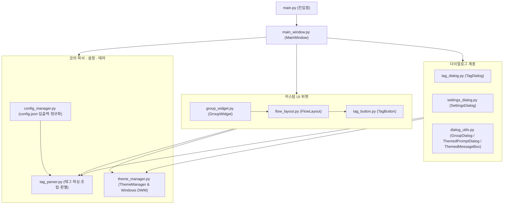

# Easy Tagger 코드 구조 및 아키텍처 요약

## 1. 전체 아키텍처 개요

Easy Tagger는 **PyQt6** 기반의 데스크톱 애플리케이션으로, 역할에 따라 **4개 계층(UI 컨트롤러 · 커스텀 위젯 · 다이얼로그 · 코어 로직/상태 관리)**으로 분리되어 있습니다.

---

## 2. 모듈별 역할 및 핵심 구성요소

### ① 진입점 및 메인 컨트롤러
| 파일 | 핵심 클래스/함수 | 주요 역할 |
| :--- | :--- | :--- |
| [`main.py`](main.py) | `main()` | `QApplication` 생성 및 `MainWindow` 실행 |
| [`main_window.py`](main_window.py) | `MainWindow` | 전체 상태 총괄 컨트롤러 • 단일/다중 활성 파일 관리 (`active_file_paths`) • 파일 드롭 태깅 (`_apply_tag_to_files`) 및 버튼 클릭 일괄 토글 (`_on_tag_button_clicked`) • 미등록 태그 자동 감지 및 `감지된 태그` 그룹 등록 (`_detect_and_register_tags_from_files`) • `Ctrl` + 드래그 기반 그룹/태그 순서 변경 및 그룹 간 이동 • 다중 파일 배치 단위 실행 취소 (`undo_stack`, `undo_last_action`) |

### ② 커스텀 위젯 & 레이아웃
| 파일 | 핵심 클래스 | 주요 역할 |
| :--- | :--- | :--- |
| [`group_widget.py`](group_widget.py) | `GroupWidget`, `GroupHeader` | 그룹 카드 컨테이너 • 헤더 클릭으로 접기/펼치기 (`▼` / `▲`) 및 `+` 버튼으로 태그 추가 • `Ctrl` + 헤더 드래그로 그룹 순서 변경 (`MIME_GROUP`) • 다른 그룹에서 드래그된 태그 드롭 수신 (`MIME_TAG`) |
| [`tag_button.py`](tag_button.py) | `TagButton` | 개별 태그 버튼 • 외부 탐색기 파일 드롭 수신 (`filesDropped` 시그널) • `Ctrl` + 드래그로 태그 순서/그룹 이동 (`tagReorderRequested` 시그널) • 활성 파일 상태에 따른 4단계 렌더링 (`none`, `on` `✓`, `partial` `◐`, `off`) |
| [`flow_layout.py`](flow_layout.py) | `FlowLayout` | 창 가로폭에 맞춰 태그 버튼들을 자동으로 줄바꿈 배치하는 커스텀 `QLayout` |

### ③ 다이얼로그 계층
| 파일 | 핵심 클래스 | 주요 역할 |
| :--- | :--- | :--- |
| [`tag_dialog.py`](tag_dialog.py) | `TagDialog` | 태그 추가/수정 창 • 단일 `태그 이름` 입력칸에서 일반(`여행`), 고정 속성(`-fps 60`), 입력형 속성(`-score ?`) 실시간 판별 • 파스텔 프리셋/커스텀 색상 선택 및 실시간 버튼·툴팁 미리보기 |
| [`settings_dialog.py`](settings_dialog.py) | `SettingsDialog` | 전역 환경 설정 창 (테마, 태그 위치 `prefix`/`suffix`, 묶음 방식 `merged`/`separate`, 버튼 높이, 항상 위에 고정) |
| [`dialog_utils.py`](dialog_utils.py) | `GroupDialog` `ThemedPromptDialog` `ThemedMessageBox` | 앱 테마 및 Windows 네이티브 타이틀바 색상이 동기화된 공용 대화상자 모음 • 창 표시 직후 입력칸 자동 포커싱 및 `Enter` 키 즉시 제출 지원 |

### ④ 코어 로직 (파서 · 설정 · 테마)
| 파일 | 핵심 클래스/함수 | 주요 역할 |
| :--- | :--- | :--- |
| [`tag_parser.py`](tag_parser.py) | `parse_tag_definition()` `extract_tags_and_base()` `assemble_filename()` `apply_tag_to_tags_list()` `remove_tag_from_tags_list()` `is_tag_in_tags()` | 파일명 및 태그 문자열 처리 순수 함수 모듈 • 태그 정의 문자열을 분석해 `normal` / `param`(`fixed`·`prompt`) 스펙으로 정규화 • 파일명에서 `[...]` 태그 블록과 순수 파일명 분리·재조립 • 속성 태그(`-키 값`) 적용 시 동일 `-키`의 기존 값 교체 |
| [`config_manager.py`](config_manager.py) | `load_config()` `save_config()` `normalize_tag_data()` | `config.json` 영구 저장 및 `config.init.json` 기본 템플릿 로드 • `config.json` 부재 시 `config.init.json` 기본 템플릿으로부터 자동 생성 • 재시작 시 `감지된 태그` 그룹 자동 삭제 및 모든 버튼 데이터 정규화 |
| [`theme_manager.py`](theme_manager.py) | `ThemeManager` | 다크 / 라이트 / 시스템 테마 스타일시트(QSS) 및 색상 계산 • 다크 모드 시 밝은 파스텔 버튼 색상을 눈부심 없는 뮤트 톤으로 자동 보정 (`adapt_color_for_theme`) • Windows DWM API(`DwmSetWindowAttribute`)를 통한 네이티브 창틀 색상 동기화 (`apply_titlebar_theme`) |
| [`icon_factory.py`](icon_factory.py) | `get_icon()` `get_pixmap()` | 모던 벡터 SVG 아이콘 팩토리 • Lucide 기반 클린 벡터 그래픽 렌더링 및 테마/색상/해상도별 자동 캐싱 • 이모지를 완전히 대체하여 네이티브 툴바 및 메뉴에 일관된 모던 UI 제공 |

### ⑤ 테스트 코드
| 파일 | 테스트 대상 |
| :--- | :--- |
| [`test_tag_parser.py`](test_tag_parser.py) | `tag_parser.py`의 태그 추출, 병합/개별 조립, 속성 태그 덮어쓰기 및 삭제 단위 테스트 |
| [`test_app_workflow.py`](test_app_workflow.py) | 단일/다중 파일 태깅 및 토글, 미등록 태그 자동 감지, 그룹/태그 드래그 이동, 다이얼로그, 설정 영구 저장 통합 테스트 |

---

## 3. 핵심 데이터 흐름 (Data Flow)

1. **파일 드롭 / 선택 흐름**:
   * **창 빈 공간 드롭**: `MainWindow.dropEvent` ➔ `_set_active_files(paths)` ➔ `_detect_and_register_tags_from_files` (미등록 태그 자동 추가) ➔ `_update_tag_buttons_highlight` (각 버튼을 `on` / `partial` / `off` 상태로 갱신)
   * **태그 버튼 위 드롭**: `TagButton.dropEvent` ➔ `filesDropped` 시그널 ➔ `MainWindow._on_files_dropped_on_button` ➔ `_resolve_tag_to_apply` (`-키 ?`인 경우 `ThemedPromptDialog` 호출) ➔ `_apply_tag_to_files` (파일명 일괄 변경 + `undo_stack` 기록 + 전체 파일을 활성 목록으로 유지)

2. **태그 버튼 클릭(토글) 흐름**:
   * `MainWindow._on_tag_button_clicked`에서 현재 활성 파일들(`active_file_paths`)에 해당 태그가 모두 있는지(`all_have_tag`) 검사
   * **모두 적용된 상태(`on`)**: 모든 활성 파일에서 해당 태그(속성 태그는 해당 `-키`)를 일괄 제거하고 `off`로 전환
   * **미적용(`off`) 또는 일부 적용(`partial`)**: 모든 활성 파일에 해당 태그를 일괄 추가하고 `on`으로 전환
